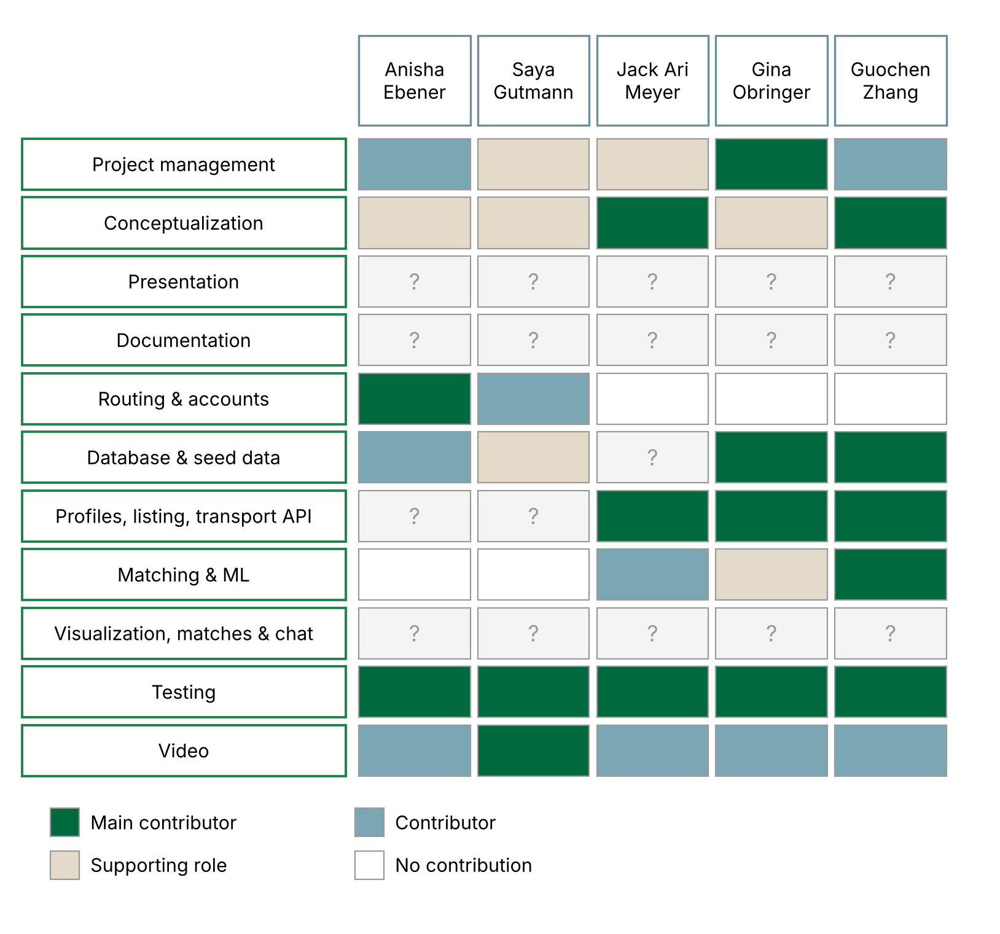

# Contribution matrix

Required by the grading criteria (no. 7) and shown in the video. Keep it honest and up to date. It's assumed to reflect reality.

| Colour | Meaning |
|---|---|
| Dark green | Main contributor |
| Teal | Contributor |
| Beige | Supporting role |
| White | No contribution |

Cells marked "?" are still being confirmed by the team.

## Where each area lives in the code

| Area | Files |
|---|---|
| Routing & accounts | `app.py`, `core/auth.py`, `views/login.py`, `views/register.py` |
| Database & seed data | `core/database.py`, `core/config.py`, `data/seed_data.py` |
| Profiles, listing, transport API | `views/profile.py`, `views/wg_listing.py`, `core/transport_api.py` |
| Matching & ML | `core/matching.py`, `core/ml_model.py`, `views/swipe.py` |
| Visualization, matches & chat | `components/charts.py`, `views/matches.py`, `views/insights.py` |
